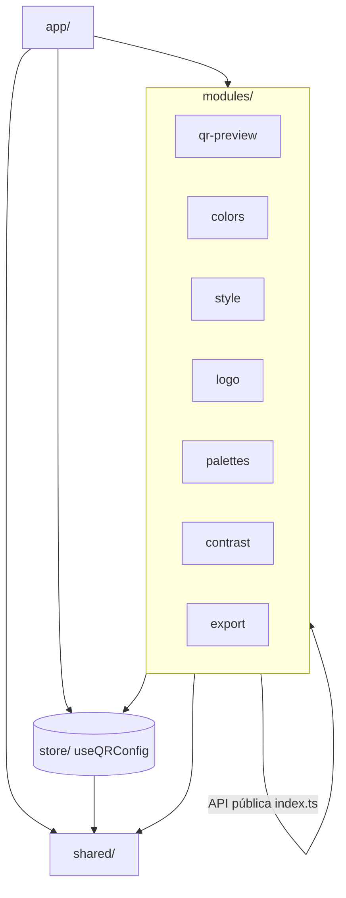

# Diseño — QR Color Studio

Documento de diseño técnico y de UX. Describe la arquitectura, los módulos, el modelo de datos,
el flujo de estado y datos, las decisiones técnicas y el plan de implementación.

> Relacionado: `docs/requirements.md` (qué debe hacer la app) y `AGENTS.md` (cómo trabajar en el repo).

---

## 1. Visión general de la arquitectura

Aplicación **monolito modular** (feature-based): un único repositorio y una única aplicación,
organizada en módulos de funcionalidad con límites explícitos. La dependencia fluye en una sola
dirección: `app/` → `modules/` → `shared/`, y `app/` → `store/` → `shared/`.

- **`modules/`** agrupan la funcionalidad de la app; cada uno expone su API pública vía `index.ts`.
- **`shared/`** contiene piezas reutilizables y agnósticas; nunca importa de `modules/`.
- **`store/`** es la única fuente de verdad de la configuración del QR.
- **`app/`** compone todo (layout, providers, estilos globales).

### Diagrama de módulos (Mermaid)



### Diagrama de dependencias (ASCII)

```
        app/
         │  compone layout + providers + estilos
         ▼
      modules/  ──(solo vía index.ts)──►  modules/
         │                                  │
         ├────────────► store/ ◄───────────┤
         │                 │
         ▼                 ▼
      shared/  ◄──────── store/
      (nunca importa de modules/)
```

---

## 2. Descripción de cada módulo

Cada módulo contiene su propio `components/`, `hooks/`, `types.ts` e `index.ts` (API pública).

### `modules/qr-preview` — Render del QR en vivo

- **Responsabilidad:** suscribirse al `useQRConfig` y renderizar el QR (lienzo oculto y/o visible)
  mediante `qr-code-styling`.
- **Componentes:** `QRPreview` (contenedor de la vista previa), `QRCanvas` (instancia del render).
- **Hooks:** `useQRInstance` (crea/actualiza la instancia del QR con debounce).
- **API pública:** `QRPreview`, `getQRInstance` (para que `export` reutilice el mismo objeto).

### `modules/colors` — Colores, degradados y selector

- **Responsabilidad:** editar color de puntos, fondo y esquinas; gestionar degradados y fondo
  transparente.
- **Componentes:** `ColorControls`, `ColorPickerField` (envoltura de `react-colorful`),
  `GradientControls`, `TransparentBackgroundToggle`.
- **Hooks:** `useColorControls` (lectura/escritura contra el store).
- **API pública:** `ColorControls`.

### `modules/style` — Formas, tamaño y corrección de errores

- **Responsabilidad:** elegir formas de puntos y esquinas, tamaño de exportación y nivel de
  corrección de errores.
- **Componentes:** `DotShapeSelector`, `CornerShapeSelector`, `SizeControl`, `ErrorCorrectionControl`.
- **Hooks:** `useStyleOptions`.
- **API pública:** `StyleControls`.

### `modules/logo` — Logo central

- **Responsabilidad:** cargar imagen (validación de tipo/tamaño), ajustar tamaño/margen y
  eliminarla.
- **Componentes:** `LogoControls`, `LogoDropzone`, `LogoSizeControl`.
- **Hooks:** `useLogo` (FileReader → data URL, sin subir a servidores).
- **API pública:** `LogoControls`.

### `modules/palettes` — Paletas predefinidas

- **Responsabilidad:** catálogo de al menos 8 paletas y su aplicación sobre el store.
- **Componentes:** `PaletteGrid`, `PaletteSwatch`.
- **Hooks:** `usePalettes`.
- **API pública:** `PaletteGrid`, y el tipo `Palette`.
- **Datos:** catálogo declarativo en `modules/palettes/constants.ts` (colores por defecto de la app).

### `modules/contrast` — Validación de contraste

- **Responsabilidad:** calcular la relación de contraste WCAG entre puntos y fondo, detectar QR
  invertido y emitir advertencias.
- **Componentes:** `ContrastWarning`, `ContrastBadge`.
- **Hooks:** `useContrast`.
- **API pública:** `ContrastWarning`.
- **Dependencia:** usa utilidades puras de `shared/utils/color`.

### `modules/export` — Descarga PNG/SVG

- **Responsabilidad:** generar y descargar el QR en PNG (con transparencia) y SVG usando la
  instancia de `qr-code-styling`.
- **Componentes:** `ExportButtons`.
- **Hooks:** `useExport`.
- **API pública:** `ExportButtons`.
- **Dependencia:** obtiene la instancia vía `qr-preview` (`getQRInstance`).

### `app/` — Composición

- **Responsabilidad:** entrada (`main.tsx`), layout de dos columnas, providers (tema, store) y
  estilos globales de Tailwind.
- **Componentes:** `App`, `AppLayout`, `ThemeProvider`, `ThemeToggle`.
- **API pública:** `App`.

### `store/` — Estado central

- **Responsabilidad:** `useQRConfig`, única fuente de verdad. Expone `config` y acciones puras
  (`setContent`, `setColor`, `applyPalette`, `reset`, ...). Persiste en `localStorage`.

### `shared/` — Reutilizables

- **`components/`** botones, inputs, sliders, toggles, cards.
- **`hooks/`** `useDebouncedValue`, `useLocalStorage`, `useMediaQuery`.
- **`utils/`** funciones puras: contraste WCAG, conversión de color, descargas.
- **`types/`** tipos transversales (formas, niveles de corrección, tema).
- **`constants/`** valores por defecto y límites (rango de tamaño, niveles de corrección).

---

## 3. Modelo de datos

### Interfaz `QRConfig`

```ts
export type GradientType = "linear" | "radial";

export type ErrorCorrectionLevel = "L" | "M" | "Q" | "H";

export type DotShape =
  | "square"
  | "rounded"
  | "dots"
  | "classy"
  | "classy-rounded"
  | "extra-rounded";

export type CornerShape = "square" | "extra-rounded" | "dot";

export interface Gradient {
  enabled: boolean;
  type: GradientType;
  rotation: number; // grados, 0–360
  colorStops: [string, string]; // [inicio, fin] en hex
}

export interface QRColors {
  dots: string; // hex
  background: string; // hex
  cornersSquare: string; // hex (marco de esquinas)
  cornersDot: string; // hex (punto de esquinas)
  transparentBackground: boolean;
}

export interface QRStyle {
  dotsShape: DotShape;
  cornerSquareShape: CornerShape;
  cornerDotShape: CornerShape;
}

export interface QRLogo {
  src: string | null; // data URL, nunca una URL remota
  size: number; // porcentaje del QR, p. ej. 0.4
  margin: number; // px alrededor del logo
  hideDotsBehind: boolean;
}

export interface QRConfig {
  content: string; // texto o URL a codificar
  colors: QRColors;
  gradient: Gradient;
  style: QRStyle;
  logo: QRLogo;
  size: number; // px, 256–1024
  errorCorrection: ErrorCorrectionLevel;
}
```

### Flujo de estado con `useQRConfig`

`useQRConfig` es una **única fuente de verdad** implementada sobre `useReducer` (o Zustand, ver
decisions) y persistida en `localStorage`.

```ts
export interface QRConfigStore {
  config: QRConfig;
  setContent: (content: string) => void;
  setColor: (key: keyof QRColors, value: string | boolean) => void;
  setGradient: (patch: Partial<Gradient>) => void;
  setStyle: (patch: Partial<QRStyle>) => void;
  setLogo: (patch: Partial<QRLogo>) => void;
  setSize: (size: number) => void;
  setErrorCorrection: (level: ErrorCorrectionLevel) => void;
  applyPalette: (palette: Palette) => void;
  reset: () => void;
}
```

Reglas:

- Las acciones son **puras y atómicas**: cada control actualiza una parte de `config`.
- Ningún módulo accede al estado interno de otro; todos pasan por el store.
- La configuración se serializa a `localStorage` (el logo se guarda como data URL; si excede el
  límite de almacenamiento, se excluye y se avisa).

---

## 4. Flujo de datos

```
[Control de UI]                        (modules/colors, style, logo, palettes)
      │  evento del usuario
      ▼
[useQRConfig.set* / applyPalette]      (store/)
      │  actualiza config (fuente de verdad)
      ▼
[qr-preview.useQRInstance]             (modules/qr-preview)
      │  debounce + qr-code-styling .update()
      ▼
[Vista previa del QR]
      │
      ▼
[export.useExport]                     (modules/export)
      │  getQRInstance().download({ extension: png | svg })
      ▼
[Archivo descargado en el navegador]
```

Además, en paralelo:

```
[config.colors] ──► [contrast.useContrast] ──► [ContrastWarning]   (advertencias WCAG)
```

---

## 5. Decisiones técnicas

### 5.1 `qr-code-styling` como motor de render

- Genera QR estilizados (formas, degradados, logo central) y exporta PNG y SVG desde una misma
  instancia.
- Permite actualizar el QR sin recrearlo (`update()`), lo que simplifica la vista previa en vivo.
- **Alternativa descartada:** `qrcode` (sin estilos ni logo) o render manual en canvas (mucho
  trabajo y frágil).

### 5.2 100% frontend, sin backend

- Requisito de privacidad (RNF-05): nada que enviar, nada que filtrar.
- Coste cero de infraestructura, despliegue estático sencillo, latencia mínima.
- `localStorage` cubre la persistencia sin necesidad de servidor.

### 5.3 `react-colorful` para el selector

- Componente ligero, accesible y sin dependencias pesadas, ideal para color plano y degradado.

### 5.4 Cálculo de contraste WCAG

- Se convierten los colores hex a sRGB lineal y se calcula la luminancia relativa.
- Relación de contraste = `(L1 + 0.05) / (L2 + 0.05)`, con `L1` la luminancia mayor.
- Umbral de aviso: **3:1** (RF-10). Un QR invertido (luminancia de los puntos mayor que la del
  fondo) se marca como advertencia específica.
- Utilidades puras y testeables en `shared/utils/color`.

### 5.5 Gestión de estado

- `useQRConfig` centraliza la configuración. Opción recomendada: `useReducer` + `Context`
  (sin dependencias extra) o Zustand si la app crece. La decisión final se toma al inicializar.
- Persistencia mediante `useLocalStorage` de `shared/hooks`.

### 5.6 Rendimiento

- Debounce de las actualizaciones del QR (`useDebouncedValue`) para no re-renderizar en cada
  pulsación o arrastre (RNF-01).
- Reutilización de una única instancia de `qr-code-styling` para render y exportación.

---

## 6. Layout y UX

### Escritorio (≥ 1024 px)

```
┌───────────────────────────────────────────────────────────┐
│  Cabecera: título + conmutador de tema claro/oscuro        │
├───────────────────────────────┬───────────────────────────┤
│  Panel de controles           │  Vista previa (sticky/fija)│
│  - Contenido                  │  ┌──────────────────────┐ │
│  - Colores y degradado        │  │        QR            │ │
│  - Formas, tamaño, corrección │  └──────────────────────┘ │
│  - Logo                       │  Advertencia de contraste  │
│  - Paletas                    │  Botones: PNG / SVG        │
│  - Exportar / Restablecer     │                            │
└───────────────────────────────┴───────────────────────────┘
```

- Controles a la izquierda (columna desplazable), vista previa **fija** a la derecha.
- Panel de controles agrupado por secciones con encabezados.

### Móvil (< 1024 px)

- Vista previa **arriba** y controles debajo (flujo vertical de una columna).
- Botones de exportación siempre alcanzables.

### Tema claro/oscuro

- Conmutador en la cabecera; persistido en `localStorage`.
- Respeta `prefers-color-scheme` por defecto; Tailwind en modo `class`.
- El lienzo del QR no se altera por el tema (el QR conserva sus colores propios).

### Lineamientos de accesibilidad

- Todas las entradas con `label` asociada y ayudas descriptivas.
- Controles de rango con `aria-valuemin/max/now`.
- Indicadores de foco visibles (nunca `outline: none` sin alternativa).
- Advertencias anunciadas con `role="alert"`/`aria-live` cuando corresponda.
- Objetivos táctiles de tamaño suficiente y contraste de UI adecuado.

---

## 7. Plan de implementación por etapas

### Etapa 1 — Base y vista previa

- Inicializar Vite + React + TS + Tailwind (cuando se solicite).
- Implementar `store/useQRConfig` y el módulo `qr-preview`.
- Campo de contenido (RF-01) y render en vivo con debounce (RNF-01).

### Etapa 2 — Colores y estilos

- Módulo `colors` (RF-02, RF-03, RF-04).
- Módulo `style` (RF-05, RF-07, RF-08).

### Etapa 3 — Logo y paletas

- Módulo `logo` (RF-06).
- Módulo `palettes` (RF-09).

### Etapa 4 — Contraste y exportación

- Módulo `contrast` (RF-10) con utilidades WCAG en `shared/utils/color`.
- Módulo `export` (RF-11) PNG/SVG.
- Persistencia completa en `localStorage` (RF-12).

### Etapa 5 — Pulido y despliegue

- Modo claro/oscuro y responsive fino (RNF-03).
- Revisión de accesibilidad (RNF-02) y textos en español (RNF-04).
- Build de producción y despliegue estático.
